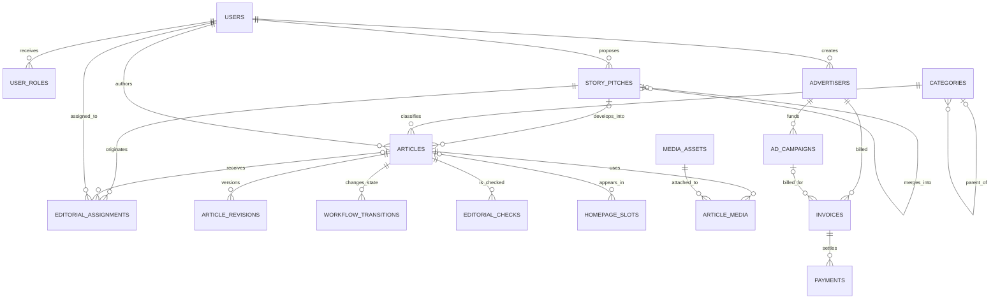

# AFRIVOX NEWS data dictionary and editorial ERD

Status: implemented schema reference for V4/V5. This document describes structure; it does not certify a production database migration or legal compliance.

## Editorial relationship model

## Core table dictionary

| Table | Purpose | Primary relationships | Sensitive fields / handling |
|---|---|---|---|
| `users` | Staff identity, account status and session revocation | roles, pitches, articles, assignments, audit | Password hashes, MFA envelope and suspension data are restricted; never expose publicly. |
| `roles`, `user_roles` | Version-controlled role assignments and optional scope/expiry | users | Privileged administrative data; changes must be audited. |
| `story_pitches` | Pitch intake, desk decision, merge and assignment hand-off | proposer, assignee, decider, assignment, article | `source_plan`, angle, cost and decision reasons are internal newsroom data. |
| `editorial_assignments` | Reporting/editing task, priority, briefing, due date and state | pitch or article, assignee and assigner | Briefings and schedules are internal. At least one of `pitch_id` or `article_id` is required. |
| `categories` | Hierarchical, language-specific public taxonomy | optional parent, articles | Public metadata; inactive categories stay out of public navigation. |
| `articles` | Canonical editorial object and controlled publication state | category, author, optional pitch/original translation | `internal_source_notes`, evidence, legal notes and review notes are restricted. Public queries must use an explicit field allow-list. |
| `article_revisions` | Immutable article snapshots | article, creator | May inherit source-sensitive text; access follows article editorial permission. |
| `workflow_transitions` | Append-only editorial state history | article, actor | Internal audit evidence; explanations may contain sensitive context. |
| `editorial_checks` | Specialist checks and outcomes | article, checker | Legal/source/fairness notes are restricted to authorized roles. |
| `media_assets`, `article_media` | Quarantined media, rights data and article placement | uploader, approver, article | Original upload paths are private; only approved derivatives are public. Rights and licensing evidence must be retained. |
| `homepage_slots` | Time-bounded placement of published stories | article, updater | Editorial scheduling data is internal until activation. |
| `audit_logs` | Tamper-evident security and privileged-action events | actor and target entity | Restricted operational evidence; redact secrets and confidential-source content from `detail`. |
| `notifications` | Internal workflow notifications | user and optional entity | Internal; avoid embedding confidential source material. |
| `subscribers` | Newsletter consent, confirmation, unsubscribe and suppression lifecycle | unique email | Confirmation/unsubscribe tokens are stored only as hashes. Only confirmed records are eligible for delivery; suppression cannot be silently reversed. |
| `public_form_attempts` | Anonymous contact/newsletter rate-limit window | form key + keyed identity digest | Stores an HMAC digest rather than raw IP address or user agent; cleanup is bounded. |
| `contact_messages` | Typed corrections, complaints, privacy/rights requests and general contact | optional assigned staff | Contains reader PII and may contain sensitive claims; access, retention and routing require approval. It is not a confidential-source channel. |
| `advertisers`, `ad_campaigns` | Advertiser identity and campaign lifecycle | creator, independent approver | Commercial contacts and contract context are restricted; commercial permissions never confer editorial authority. |
| `invoices`, `payments` | Integer-money billing and settlement ledger | advertiser, optional campaign, creator/recorder | Idempotency keys prevent duplicates; invoice creator/payment recorder identity separation is enforced in the application. External statement reconciliation remains required. |

## Newsroom state vocabularies

### Pitch status

`submitted` → one of `clarification`, `accepted`, `rejected`, `hold`, or `merged`; an accepted pitch becomes `assigned` when an assignment is created, and completed work may be marked `closed`.

The application applies optimistic locking through `lock_version`, so a stale desk decision cannot overwrite a newer one.

### Assignment status

`assigned` → `in_progress` → `completed`; authorized desk staff may move active work to `cancelled`. The timestamps `started_at` and `completed_at` record operational milestones.

### Article status

`draft` → `submitted` → `under_review` → specialist queues when required → `approved` → `scheduled` or `published`. Corrections, unpublishing, retraction and archival remain explicit controlled states; workflow transitions are recorded separately.

## Integrity rules

- Pitches, assignments and articles use foreign keys in the fresh-production schema; migration files add the new relationships using `INFORMATION_SCHEMA` guards.
- A newsroom assignment must target a pitch or article. `article_id` is nullable specifically so a desk can assign an accepted pitch before an article exists.
- Category parent deletion sets child `parent_id` to `NULL`; it does not delete stories.
- Optional article-to-pitch links can be set to `NULL`, but assignment targets use restrictive foreign keys. Editorial records should be archived rather than deleted so the assignment history remains attributable.
- Currency values are integer `*_minor` units with an ISO 4217 code. A finance owner must confirm the display/rounding policy for RWF before live billing.
- Dates are stored as server-side `DATETIME`; production deployment must standardize UTC storage and localized display.

## Migration order

1. `schema.sql` for a clean database, or existing migrations through `20261029_v3_security_gates.sql`.
2. `20261029_v4_newsroom_operations.sql`.
3. `20261029_v5_taxonomy.sql`.
4. `20261029_v5_audience.sql`.
5. Run backup, migration preflight, row-count/integrity checks and rollback rehearsal on staging before production.

SQLite in `tools/setup_local_sqlite.php` is a developer preview approximation. MySQL/MariaDB staging remains the release authority for foreign keys, enum behavior, query plans and concurrency.
